# FablePreSolve: extensions of the noise46 model

Written on 15 November 2026. Every extension is one Julia file in this folder. Each section below gives the idea, how it is implemented, what it finds, and how hard it is to carry into the paper.

## How to read this

- **Model.** All runs use `Baseline_noise46.jl` (valuation noise, calibration FU2, grid 46/23/46/46). `Model_ext.jl` is a copy of its model part with two switches that are off by default. With the switches off it reproduces noise46 bit for bit (`E00_check.jl`: `SumPol`, `Fmat`, `mu` and `c_e` are identical for the baseline and for a reform solve).
- **Reform.** "The reform" is ζ/3 for all firms at its general-equilibrium wage, compared with the baseline. ζ/2 is shown where it costs nothing.
- **Y/L.** Output per worker equals the wage divided by ν, so the Y/L gain is the wage gain.
- **Consumption (C).** Steady-state consumption, main5's C = Y − I − Ψ. It charges every potential entrant the entry cost, as the code's free-entry condition does. "C main5" charges only the entrants that stay, as main5's Ψ is written. The two differ a lot (see E01).
- **Liquidated share of defaults.** A flow: of the borrowers that default in a year, the share that is liquidated. It is 61% in the baseline. The calibrated moment is something else: the firm average of the liquidation probability, 42%.
- **Running.** `bash run.sh E02_firm_dynamics E04_size_gradient` runs files side by side; logs go to `logs/`, tables and figures to `out/<name>/`. Solved equilibria are cached in `out/cache/` (delete it after changing `Model_ext.jl`). One solve takes about 3 seconds, one GE wage search about 30 seconds.

## Overview

| # | Extension | File | Carried out | Effort for the paper |
|---|---|---|---|---|
| E01 | Welfare and resource table | `E01_welfare.jl` | Yes | Easy |
| E02 | Firm dynamics and lender recoveries | `E02_firm_dynamics.jl` | Yes | Easy |
| E03 | Targeted reform against the Subchapter V evidence | `E03_subv_validation.jl` | Yes | Easy |
| E04, E15 | Size gradient; U-shape of CF debt in size | `E04_size_gradient.jl` | Yes | Easy |
| E05 | The whole ζ curve and the perfect-credit gap | `E05_zeta_curve.jl` | Yes | Easy |
| E06, E17 | Cost reform versus bargaining reform; European costs | `E06_cost_vs_bargaining.jl` | Yes | Easy |
| E07 | Channels: court, loan prices, wage | `E07_channels.jl` | Yes | Easy to medium |
| E08, E13 | Eligibility cap; eligibility by debt or by capital | `E08_cap_sweep.jl` | Yes | Medium |
| E09 | Mistaken liquidations and reorganizations | `E09_mistakes.jl` | Yes | Easy |
| E10 | Life cycle of an entry cohort | `E10_age_profiles.jl` | Yes | Easy |
| E11 | Event study around default | `E11_event_study.jl` | Yes | Easy |
| E12 | Welfare-maximizing liquidation rule (and without noise) | `E12_optimal_wedge.jl`, `E12b_wedge_noiseless.jl` | Yes | Easy to medium |
| E14 | Which firms the reform saves (zombies) | `E14_zombies.jl` | Yes | Easy |
| E16 | Reform gain and asset pledgeability | `E16_pledgeability.jl` | Yes, without refit | Easy; with refit see H1 |
| E18, E19 | Fire-sale and court-congestion feedbacks | `E18_feedbacks.jl` | Yes | Medium (elasticities need a source) |
| E20 | Reorganization subsidy versus credit guarantee | `E20_guarantee.jl` | Yes | Medium |
| E21 | Transition path | `E21_transition.jl` | Partly: bounds only | Hard |
| E22 | One-off revenue shock | `E22_covid_shock.jl` | Shock year only | Hard beyond the shock year |
| H1 | E16 with a refit at each φ_a | `H1_phi_a_refit.jl` | Yes (two lazy refits, 18 minutes each) | Medium |

The shared code is in `common.jl`. Its core is `events(E)`: for every continuing firm it lists what happens next period (production, repayment, default, liquidation or reorganization) exactly as the model's law of motion does. The events reproduce the stationary distribution to 1e-17, so all flow numbers below are consistent with the solved model.

---

## E01. Welfare and the resource table

**Idea.** Comparable papers report what a bankruptcy reform does to consumption, not only to output (Corbae and D'Erasmo Table 5; Kim Table 10, where output falls and consumption rises).

**Implementation.** Consumption is output minus investment and all costs: fixed operating costs, entry costs, capital and profits lost in liquidation, and the fixed and variable reorganization costs. Every flow comes from `events`.

**Findings.**

| | ζ/2 | ζ/3 |
|---|---|---|
| Y/L (wage) | +0.81% | +1.14% |
| Consumption | +1.26% | +1.85% |
| Consumption, main5 entry costs | +0.42% | +1.00% |
| Consumption, reorganization costs as transfers | +1.03% | +1.42% |
| Producing firms | +8.5% | +11.9% |
| Potential entrants | −7.8% | −7.3% |
| Entrants that stay | +11.7% | +12.3% |

- Consumption rises by more than output per worker, because entry costs and ζ outlays fall.
- For ζ/3, in percentage points of baseline consumption: output +1.51, entry costs +0.51, ζ outlays +0.44, liquidation losses +0.07, investment −0.33, fixed operating costs −0.33, variable reorganization cost −0.03.
- The entry-cost convention moves the answer by about 0.8 points. Fewer draws are needed (40% of them stay, against 33%), but more entrants stay. The code's free entry charges per draw.

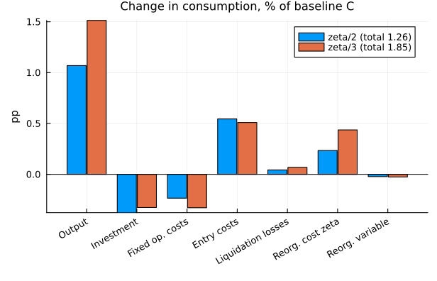

**Implementability.** Easy. It is post-processing. The one decision is the entry timing in the text of the paper.

---

## E02. Firm dynamics and lender recoveries

**Idea.** A standard validation table: entry, exit and default rates, and what lenders recover in each procedure (Bris, Welch and Zhu: Chapter 11 preserves value better).

**Implementation.** All rates are flows from `events`. Recovery is what the lender receives per unit of face value, by procedure, for mostly asset-based (τ < 0.5) and mostly CF-based borrowers.

**Findings.**

| | Baseline | ζ/3 |
|---|---|---|
| Entry rate = exit rate, % of firms | 6.8 | 6.8 |
| Default rate, % of borrowers | 3.1 | 3.6 |
| Defaults by firms without debt, % of defaults | 50 | 47 |
| Liquidated share of borrowers' defaults, % | 61 | 49 |
| Lender recovery in liquidation, % of face value | 12 | 10 |
| Lender recovery in reorganization, % | 45 | 45 |
| CF borrowers: liquidation / reorganization, % | 10 / 45 | 8 / 44 |
| Asset-based borrowers: liquidation / reorganization, % | 61 / 79 | 50 / 72 |

- Reorganization recovers about four times as much as liquidation, the right sign against the data.
- 98% of defaulted debt is CF-based. Asset-based borrowers almost never default.
- Half of all defaults are firms with no debt and no capital. These are mostly entrants that wait without capital and walk away from the fixed operating cost when productivity does not improve. Default rates over all firms are therefore not comparable with data on bankruptcies; the borrower rate is.
- The default rate of borrowers rises with the reform, from 3.1% to 3.6%.

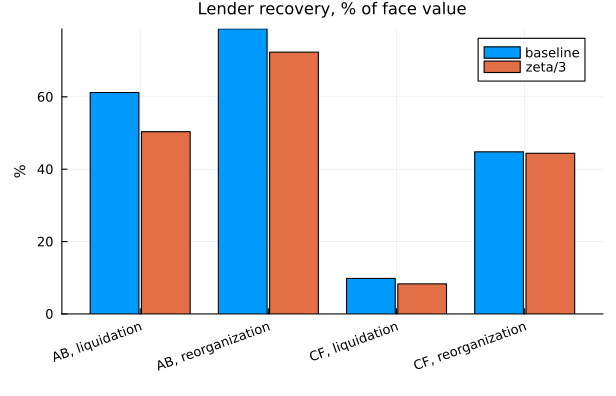

**Implementability.** Easy. Recovery rates could become untargeted moments. The recovery in liquidation (12%) looks low against the data and is worth checking.

---

## E03. The targeted reform against the Subchapter V evidence

**Idea.** Hotchkiss, Iverson and Zheng (2024) give causal estimates for Subchapter V: eligible firms confirm a plan 21 points more often (from 33%), filings do not rise, creditors recover no less, and survival after bankruptcy is no lower. The model's targeted reform can be held against each of these.

**Implementation.** The targeted reform is the one in the RESULTS section: ζ is cut for small borrowers only (debt below the model's size cut) until their average liquidation probability falls by 13 points at the baseline wage, then the wage is solved. Small borrowers' defaults, recoveries and later survival come from `events`.

**Findings (small borrowers).**

| | Baseline | Targeted | Evidence |
|---|---|---|---|
| Reorganized share of defaults | 37% | 48% | 33% → 54% (plan confirmed) |
| Default rate, % of borrowers | 4.2 | 5.0 | filings did not rise |
| Lender recovery in default, % of face value | 43 | 50 | not lower |
| Interest rate, % | 7.0 | 6.4 | – |
| Reorganized firms operating after 3 years | 87% | 85% | not lower |
| Reorganized firms defaulting again within 3 years | 6.5% | 11.0% | – |

- The baseline level is close to the data (37% against 33%), untargeted. The reform raises it by 11 points, about half of the estimated 21.
- Creditors are not harmed: recoveries rise and the loan rate falls. This matches the evidence.
- Two misses. Defaults rise by 17% in the model, and reorganized firms survive slightly less often.
- Large borrowers are unaffected in every row.
- In aggregate the targeted reform gives Y/L +0.91% and consumption +1.42%, against +1.14% and +1.85% for ζ/3 for everyone.

The model's "small" firms are the bottom two thirds of borrowers (the $1bn split of the targets), not firms under $7.5m. The comparison is qualitative.

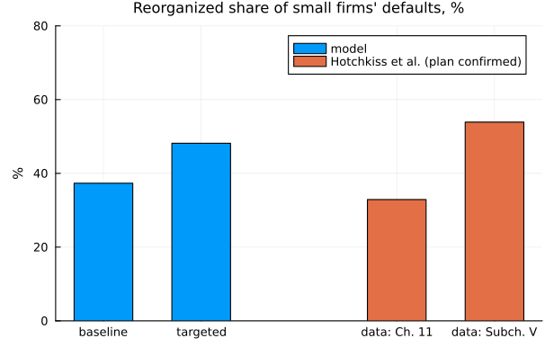

**Implementability.** Easy. It gives the paper an external check that it lacks. A reform sized to the 21 points would be a small extension of `find_zeta_Rs`.

---

## E04 and E15. The size gradient, and the U-shape

**Idea.** The paper's facts have more than two size groups. Does the model produce a gradient across the whole distribution, and which firms change their debt after the reform? Separately, a paper on Argentina reports that the CF share of debt is U-shaped in firm size.

**Implementation.** Borrowers are sorted into bins of debt, cut at the deciles of the baseline (so both economies are compared at the same debt levels). All firms are also sorted into deciles of employment.

**Findings.**

- The liquidated share of defaults falls from 94% in the smallest debt bin to 22% in the largest. CF reliance rises from 0.16 to 0.75.
- The reform changes the lower middle of the distribution. CF reliance rises by 0.2 to 0.25 in bins two to four (for example 0.43 to 0.69), and by 0.02 to 0.05 in the top three bins. The liquidated share falls by 10 to 20 points in the same middle bins.
- The smallest bin does not move: it is still liquidated 94% of the time.
- By employment, the debt-weighted CF share is U-shaped in the baseline: 0.67 in the first decile, 0.25 in the third, 0.75 at the top. The firm-average CF reliance is not U-shaped (0.30, 0.24, 0.30, then rising). The reform flattens the U (0.80, 0.70, 0.55, then rising).

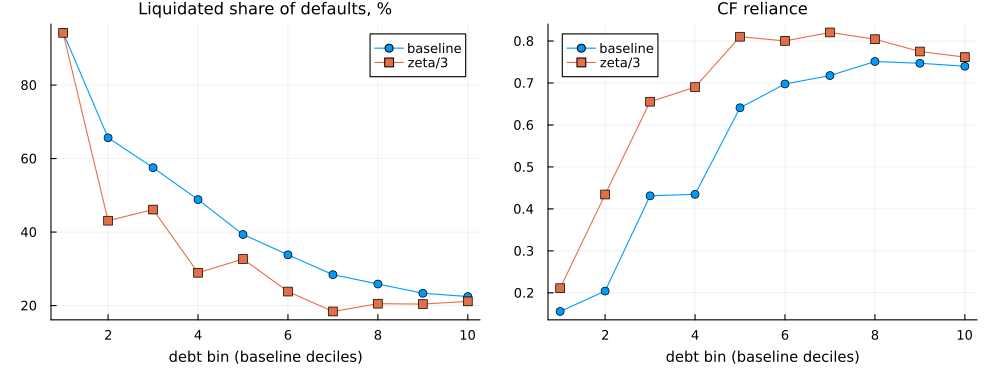

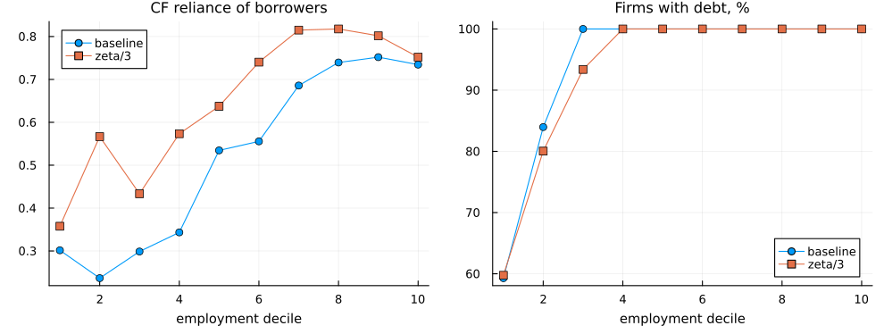

**Implementability.** Easy. The by-bin picture is a good candidate for the paper, since it shows who responds. Interest rates by bin are noisy because debt sits on a grid.

---

## E05. The whole ζ curve

**Idea.** Tamayo compares bankruptcy regimes from liquidation-only to efficient reorganization. The same curve here, plus the perfect-credit benchmark, tells how much of the cost of credit frictions bankruptcy costs account for.

**Implementation.** ζ from 0 to 20 times its baseline value (at 20 times nearly every default is liquidated), each in GE. Perfect credit is the RESULTS section's benchmark (equity injections are free).

**Findings.**

| ζ, multiple of baseline | Y/L | Consumption | Liquidated share of defaults | CF reliance |
|---|---|---|---|---|
| 0 | +2.4% | +4.1% | 20% | 0.83 |
| 1/3 | +1.1% | +1.8% | 49% | 0.67 |
| 1/2 | +0.8% | +1.3% | 53% | 0.64 |
| 1 | 0 | 0 | 61% | 0.54 |
| 2 | −1.1% | −1.8% | 68% | 0.43 |
| 5 | −2.5% | −3.8% | 82% | 0.27 |
| 20 (liquidation only) | −5.3% | −7.2% | 87% | 0.08 |
| Perfect credit | +11.0% | +10.2% | – | – |

- The curve is monotone and steep on both sides. Between a liquidation-only law and costless reorganization, output per worker differs by 7.7%.
- ζ/3 closes 10% of the gap between the baseline and perfect credit; ζ = 0 closes 22%.
- Without reorganization CF debt nearly disappears (CF reliance 0.08).

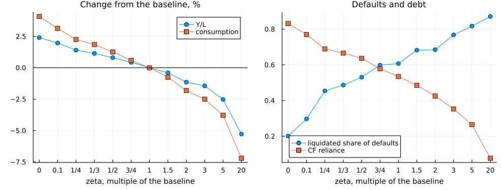

**Implementability.** Easy. One figure. It also shows the reform result is not a local accident of ζ/2.

---

## E06 and E17. Cost reform versus bargaining reform; European costs

**Idea.** The evidence on debtor-friendly reforms conflicts. Italy's reorganization reform raised loan rates (Rodano et al. 2016); Subchapter V did not hurt creditors. A reform can cut the cost of the procedure (ζ) and it can shift value from the lender to the owner (θ, the lender's share of the reorganized firm). The model has both levers.

**Implementation.** ζ, ζ/2 and ζ/3 combined with θ cut by 0 to 60%, each in GE. For E17, ζ doubled and tripled with a weaker lender position.

**Findings.**

| θ, multiple of baseline | ζ: Y/L | ζ/2: Y/L | ζ/3: Y/L | ζ/3: CF share of debt |
|---|---|---|---|---|
| 1.0 | 0 | +0.81% | +1.14% | 0.77 |
| 0.8 | −0.52% | +0.28% | +0.71% | 0.71 |
| 0.7 | −0.80% | −0.02% | +0.26% | 0.44 |
| 0.6 | −0.97% | −0.43% | −0.06% | 0.19 |
| 0.5 | −1.47% | −0.79% | −0.52% | 0.04 |

- Cutting the lender's share alone lowers output per worker and wipes out CF debt: at θ × 0.5 the CF share of debt is 2%.
- **Break-even.** The Y/L gain of ζ/2 is gone if the lender's share falls by 29%; the gain of ζ/3 is gone at a 38% fall.
- Consumption is more robust, because lower ζ outlays count directly: ζ/2 breaks even at a 51% fall, ζ/3 stays positive on the whole grid.
- This reconciles the two pieces of evidence: a reform that mostly cuts costs helps, one that mostly shifts bargaining power raises the cost of credit.
- **European costs (E17).** With ζ doubled, Y/L is 1.1% lower and CF reliance 0.43. With ζ tripled and θ halved, Y/L is 2.8% lower, consumption 3.5% lower, and CF debt is gone (share 1%).

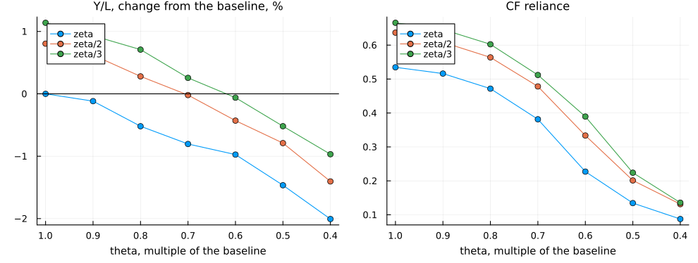

**Implementability.** Easy: both parameters are existing overrides. The break-even is a clean, quotable number. It needs evidence on how much Subchapter V lowered lenders' share.

---

## E07. Through which channel does the reform work?

**Idea.** A cheaper reorganization helps after a default (fewer firms are destroyed) and before it (credit is cheaper). Agrawal et al. (2021) find for Denmark that the effect on solvent firms dominates. Which one drives the model?

**Implementation.** Three steps from the baseline to ζ/3. Step 1: the court uses ζ/3, but lenders price loans as in the baseline (the new switch `Q_FIXED`) and the wage stays at 1. Step 2: lenders reprice, wage still at 1. Step 3: the wage rises until free entry holds.

**Findings.**

| Step | Wage | Entry value | Consumption | Firms | Liquidated share of defaults | CF reliance |
|---|---|---|---|---|---|---|
| 1 Court only | 0 | 0 | +0.97% | +3.9% | 61% → 41% | 0.54 → 0.52 |
| 2 + Loan prices | 0 | +7.3% | +0.82% | +8.9% | 48% | 0.66 |
| 3 + Wage (GE) | +1.14% | 0 | +1.85% | +11.9% | 49% | 0.67 |

- With loan prices frozen, firms' choices and values do not change at all (checked: identical policies). The owner gets nothing in a default either way, so only the lender's pricing carries the reform to the firm.
- So the whole Y/L gain runs through credit pricing: repricing raises the value of entering by 7.3%, and the wage rises until that is competed away.
- About half of the consumption gain is there with the court alone: fewer firms destroyed and lower ζ outlays.
- CF reliance moves only when lenders reprice.

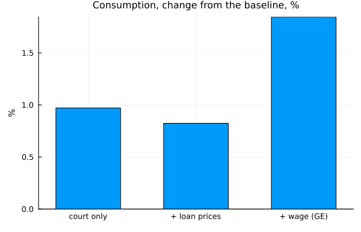

**Implementability.** Easy to medium. It needs the `Q_FIXED` switch in `FirmOptim` (five lines). The clean split between "after default" and "before default" is a result worth a paragraph in the paper.

---

## E08 and E13. Who should be eligible?

**Idea.** The Subchapter V cap moved from $2.7m to $7.5m and back to $3.0m in June 2024. How does the gain depend on the cap, and do firms bunch below it? Separately, Kim (2021) finds the Chapter 11 cost disadvantage in small-asset firms, not small-debt firms: does the size criterion matter?

**Implementation.** ζ/3 only for borrowers with debt below a cap, for eight caps, each in GE. The caps sit between two points of the debt grid, so no firm is exactly at the cap. Bunching compares the mass at the grid point just below the cap with the baseline. For E13 the same cut goes to the same share of borrowers, chosen by debt or by capital.

**Findings.**

| Eligible share of baseline borrowers | Y/L | Consumption |
|---|---|---|
| 9% | 0.00% | +0.01% |
| 20% | +0.31% | +0.62% |
| 35% | +1.02% | +1.54% |
| 51% | +1.13% | +1.67% |
| 68% (the model's size cut) | +1.14% | +1.74% |
| 100% | +1.14% | +1.85% |

- Nearly all of the Y/L gain comes from borrowers between the 10th and the 50th percentile of debt. Making the largest half eligible adds nothing to output per worker and 0.2 points of consumption.
- The smallest 9% do not respond at all: they are liquidated anyway (E04).
- Bunching appears at one cap only: with 20% eligible, the mass just below the cap doubles (2.1% to 4.1% of borrowers) and the point just above empties. At the other caps there is none.
- **Debt or capital (E13).** No difference: Y/L +1.138% and consumption +1.736% under both. Debt and capital are almost proportional across the model's firms, so the two criteria pick the same firms. The model cannot speak to Kim's distinction.

In model units $7.5m lies below the smallest debt bin, so the cap sweep is about the shape, not the dollar level.

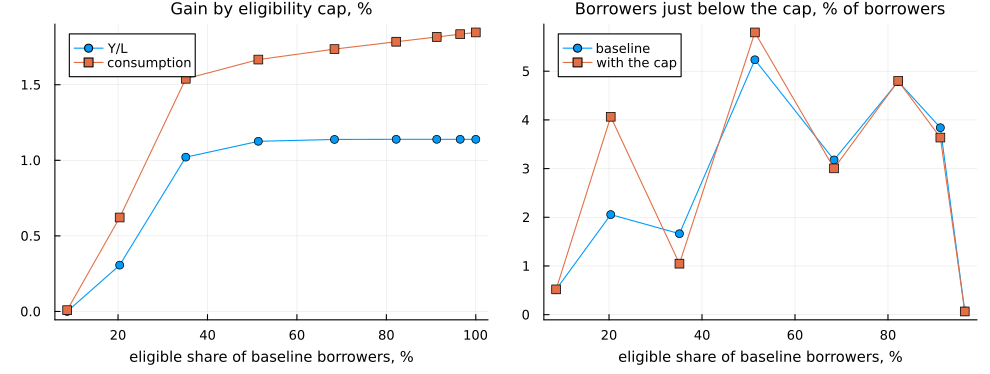

**Implementability.** Medium. The sweep is easy, but mapping model debt to dollars needs the size split to be redone at a small-business cut.

---

## E09. How often is the court wrong?

**Idea.** The noise that matches large firms' liquidations means the court makes mistakes. How many, and how costly? The empirical literature disagrees: Antill (2022) finds many value-destroying liquidations; Dou et al. (2021) find excess liquidation and continuation to be small; Jenkins and Smith (2014) put the loss at up to 0.28% of going-concern value.

**Implementation.** For each defaulting borrower the noiseless court's decision is known: liquidate when the liquidation value plus ζ exceeds the reorganization value. A liquidation of a firm the noiseless court would reorganize is a mistake, and the reverse. The value lost is the gap between the two sides.

**Findings (baseline).**

- 23% of liquidations and 48% of reorganizations are mistakes. One third of all defaults are resolved wrongly.
- Large borrowers: the noiseless court would never liquidate one. All of their liquidations (24% of their defaults) are mistakes. So the large-firm liquidation moment is matched by errors alone.
- Value lost in mistaken liquidations is 18% of the value of the defaulting firms, and all mistakes cost 0.6% of consumption.
- After ζ/3 the noiseless court would liquidate 37% of defaults, but 49% are liquidated: 41% of liquidations are then mistakes.

This is far above the estimates in the literature (well under 1% of value in Jenkins and Smith; "small" in Dou et al.). It is the clearest sign that σ_v ≈ 1.5 is too much noise to defend as valuation error alone.

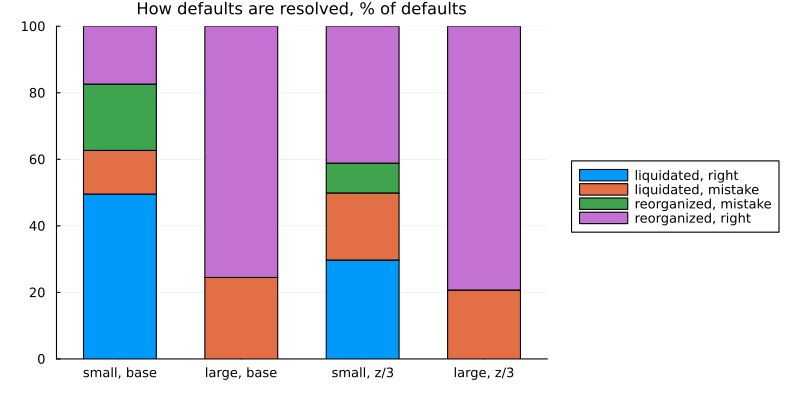

**Implementability.** Easy as a table. It is a diagnostic of the noise model more than a result to advertise.

---

## E10. The life cycle of an entry cohort

**Idea.** Kochen, Khan, Senga and Thomas, and Tamayo show how financial frictions shape young firms. Here: when do firms move from asset-based to CF debt, and does the reform change the life cycle?

**Implementation.** One cohort of entrants is pushed through the law of motion for 30 years. At each age the survivors' choices are averaged. Baseline and ζ/3, each at its own wage.

**Findings.**

- **CF reliance is higher at every age after the reform**, and the gap widens with age: 0.61 against 0.72 at entry, 0.59 against 0.72 at age 10, 0.46 against 0.60 at age 30. This is the cleanest before/after difference in the set.
- Firms are smaller at every age (1,229 employees at age 10 against 1,449), because the wage is higher and there are more firms.
- Survival is nearly unchanged: 31% of entrants are alive at age 10 in both.
- About half of the entrants disappear in the first year in both economies. These are the entrants without capital of E02.
- CF reliance peaks at age 1 to 2 and then declines with age in both economies: older firms have more capital to pledge.

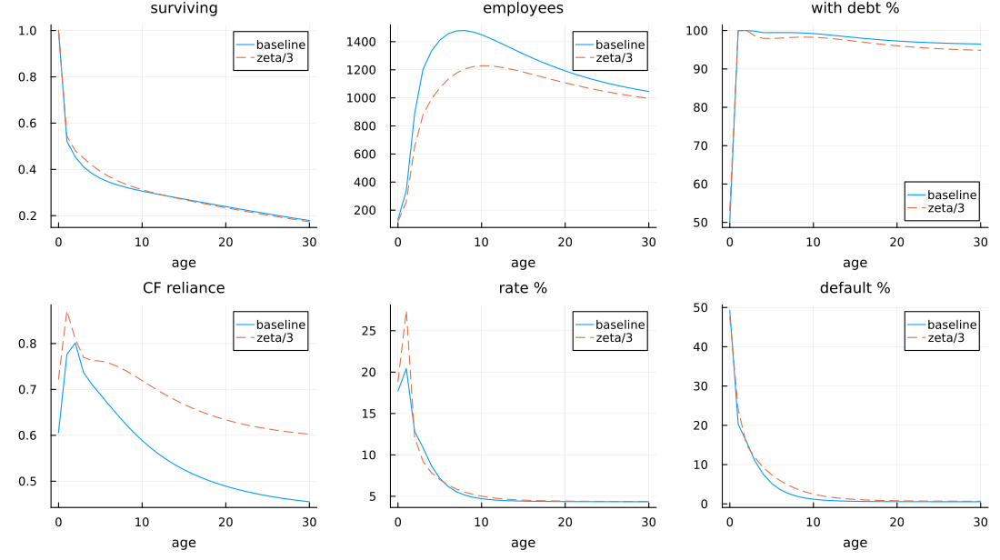

**Implementability.** Easy. Needs data counterparts by age to be more than an illustration.

---

## E11. Firms around a default

**Idea.** Corbae and D'Erasmo test their model on the years around a bankruptcy, which they do not target.

**Implementation.** Year 0 is the default. Before it, firms are weighted by the exact probability that they are reorganized (or liquidated) j years later. After it, the reorganized firms are followed from their fresh start. Averages are relative to all continuing firms.

**Findings (baseline).**

- Firms that will be reorganized shrink for five years before the default: capital falls from 0.81 to 0.34 of the average, while debt to capital rises from 1.07 to 1.59. Productivity drifts down only slightly (1.05 to 0.99).
- They are heavy CF borrowers before the default (CF reliance 0.70 to 0.82) and much less so after it (0.44).
- After the fresh start, debt to capital is 0.77 and capital recovers from 0.50 to 0.67 of the average within five years. 76% are still operating after five years.
- Firms that will be liquidated are much smaller (capital 0.03 of the average in the last year) and less productive (0.86).
- After the reform, reorganized firms are smaller and slightly less productive, and fewer survive five years (66% against 76%): the reform saves weaker firms (see E14).

The run-up in leverage before default matches the pattern in Corbae and D'Erasmo's data.

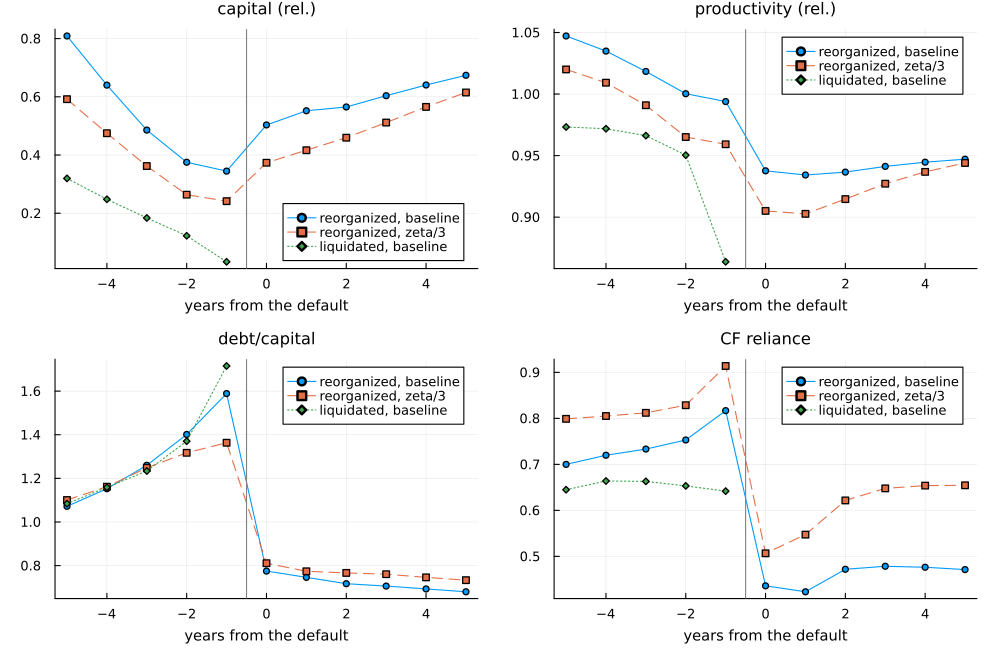

**Implementability.** Easy on the model side. The data side (Compustat firms around Chapter 11) is the real work.

---

## E12. Is the court's liquidation rule the best one?

**Idea.** The court liquidates when that is worth more than reorganizing after the default. It ignores that a higher chance of liquidation makes CF debt dearer before the default. The paper asserts this inefficiency; here it is measured.

**Implementation.** One new parameter, `liq_wedge`: the court acts as if the reorganization value were e^wedge times higher. Positive values mean fewer liquidations. Each value is solved in GE.

**Findings.**

| Wedge (log points) | Y/L | Consumption | Consumption, main5 entry | Liquidated share | CF reliance |
|---|---|---|---|---|---|
| −1 | −1.4% | −1.5% | −1.2% | 76% | 0.27 |
| 0 (the model's court) | 0 | 0 | 0 | 61% | 0.54 |
| 1 | +1.1% | +0.8% | −0.1% | 46% | 0.74 |
| 1.5 | +1.7% | +1.25% | +0.4% | 41% | 0.81 |
| 2 | +2.0% | +1.2% | +0.2% | 30% | 0.88 |
| 4 | +2.4% | +0.7% | −0.5% | 17% | 0.95 |

- Output per worker rises all the way: the less the court liquidates, the cheaper CF credit.
- Consumption peaks at a wedge of about 1.5: a court that values reorganization about 4.5 times too high. Beyond that, too many weak firms are kept.
- The best rule gives about as much as halving ζ (+1.25% against +1.26%), without any cost reduction.
- The two add up: ζ/3 with a wedge of 2 gives consumption +3.1%.
- Under main5's entry-cost convention the gain is small and not monotone (+0.4% at best), so the welfare case depends on the entry timing.

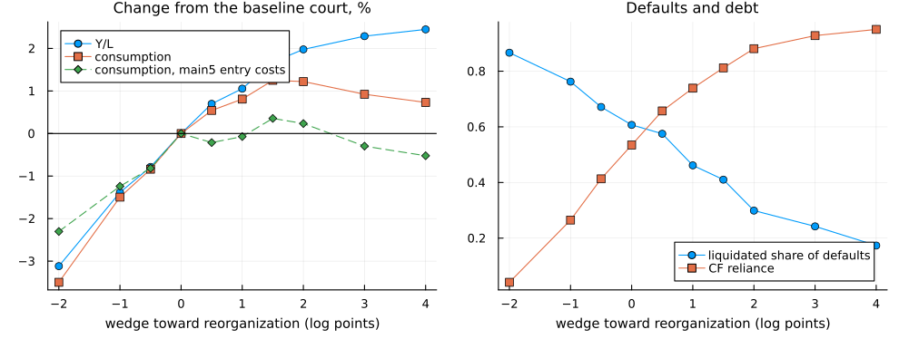

**Without noise (`E12b_wedge_noiseless.jl`).** On noise46 part of the wedge's benefit could be that it undoes noise: large firms are only ever liquidated by mistake (E09). So the sweep is repeated on the noiseless model, `Baseline.jl`'s calibration set as overrides (it reproduces that file's entry cost, 340.776, and its ζ/2 gain, 2.38%). There the court makes no errors, and the result is stronger:

| Wedge | Y/L | Consumption | Consumption, main5 entry | Liquidated share |
|---|---|---|---|---|
| −0.5 | −1.2% | −1.2% | −0.7% | 76% |
| 0 | 0 | 0 | 0 | 69% |
| 0.25 | +1.1% | +1.0% | +0.5% | 68% |
| 0.75 | +2.5% | +1.7% | +0.9% | 56% |
| 1 | +2.8% | +1.3% | −0.3% | 36% |
| 2 | +3.5% | +0.7% | −1.1% | 13% |

- Consumption peaks at a wedge of 0.75 (a court that values reorganization about twice too high), under both entry-cost conventions.
- So a court that decides correctly at the moment of default liquidates too much from the point of view of the economy, and this does not depend on valuation noise.

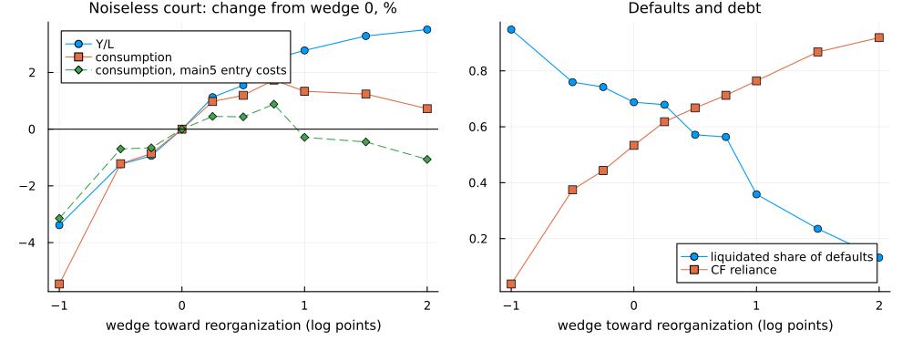

**Implementability.** Easy to medium: one line in `fn_Gam` and a sweep. This is the most novel result of the set.

---

## E14. Which firms does the reform save?

**Idea.** The reform lowers average productivity (the composition effect). Is it keeping zombies alive? Hotchkiss, Iverson and Zheng find no bias toward unviable firms under Subchapter V.

**Implementation.** In the ζ/3 economy each defaulting firm has a liquidation probability under the new and under the old cost. The difference is the mass saved by the reform. The saved firms are compared with the firms reorganized under both costs, the firms still liquidated, the average firm, and entrants.

**Findings.**

| Group | Share of defaults | Productivity (avg = 1) | Capital (avg = 1) | Operating after 3 years | Defaults again within 3 years |
|---|---|---|---|---|---|
| Saved by the reform | 19% | 0.87 | 0.05 | 75% | 19% |
| Reorganized under both | 32% | 0.93 | 0.36 | 85% | 12% |
| Still liquidated | 49% | 0.83 | 0.08 | – | – |
| Average firm | – | 1.00 | 1.00 | 90% | 8% |
| Entrants | – | 0.92 | 0.06 | 78% | 47% |

- Saved firms are weaker than the firms that were reorganized anyway: less productive, much smaller, and more likely to fail again.
- They are not weaker than the firms that replace them. Their three-year survival is about that of entrants, and they default again far less often.

So the saved firms are marginal but not zombies by the standard of the marginal entrant.

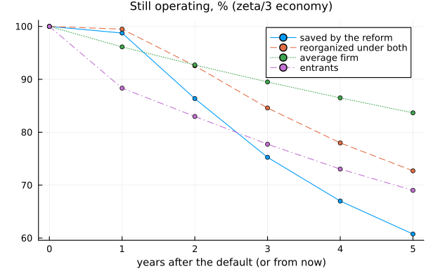

**Implementability.** Easy. A short table that answers the excess-continuation objection.

---

## E16. Reform gain and asset pledgeability

**Idea.** φ_a is the resale value of capital. It is lower where assets are specific (Kermani and Ma) or intangible. Does bankruptcy design matter more there?

**Implementation.** φ_a from 0.25 to 0.7, each economy solved in GE with the baseline entry cost and no refit, with ζ and with ζ/3.

**Findings.**

| φ_a | CF share of debt before the reform | Y/L gain of ζ/3 | Consumption gain |
|---|---|---|---|
| 0.25 | 0.89 | +1.18% | +1.94% |
| 0.35 | 0.79 | +1.14% | +1.85% |
| 0.425 (calibrated) | 0.73 | +1.14% | +1.85% |
| 0.5 | 0.42 | +1.15% | +1.87% |
| 0.6 | 0.03 | +1.13% | +1.84% |
| 0.7 | 0.01 | +1.02% | +1.74% |

- The mix of debt is very sensitive to φ_a: the CF share falls from 0.73 to 0.42 between 0.425 and 0.5, and to 3% at 0.6. Low resale values mean CF lending, as in Kermani and Ma.
- The reform gain is almost flat, falling only mildly with φ_a. The conjecture that the reform matters much more with intangible capital is not supported.
- Even an economy that borrows almost only against assets (φ_a = 0.6) gains 1.1%: the reform lets firms switch to CF debt.

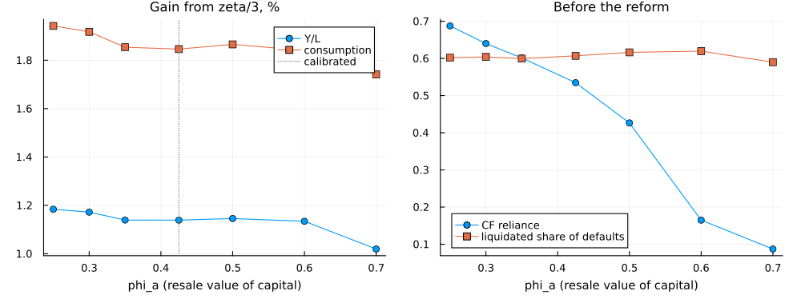

**Implementability.** Easy without a refit. With a refit at each φ_a see H1.

---

## E18 and E19. Two aggregate feedbacks

**Idea.** Liquidations depress resale prices (fire sales: Bernardo, Schwartz and Welch; Bernstein et al.), and more cases congest courts (Iverson). Both are outside the model and could amplify or erode the reform.

**Implementation.** An outer loop around the GE solve. Fire sales: φ_a falls with the capital liquidated, with elasticity η, normalized so the baseline is unchanged. Congestion: ζ rises with the number of reorganizations, with elasticity η. The loop iterates until the price or cost is consistent with the flows. The elasticities are not calibrated; three values each.

**Findings.**

| | Y/L gain of ζ/3 | Consumption gain |
|---|---|---|
| No feedback | +1.14% | +1.85% |
| Fire sales, η = 0.25 / 0.5 / 1 | +1.17 / +1.19 / +1.21% | +1.86 / +1.87 / +1.87% |
| Congestion, η = 0.25 / 0.5 / 1 | +1.00 / +0.93 / +0.80% | +1.66 / +1.51 / +1.24% |

- The reform cuts liquidated capital by 13%, so resale prices rise (φ_a from 0.425 to 0.44–0.46) and the gain is slightly larger. The amplification is small.
- Reorganizations rise by 71%. With an elasticity of 1 the effective cost ends at 0.51 of the baseline in place of 0.33, and 30% of the Y/L gain is lost.

So congestion is the feedback that matters for a reform that works by raising the number of cases.

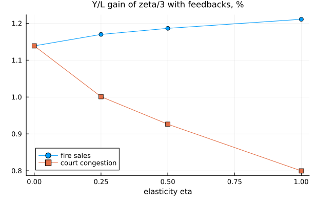

**Implementability.** Medium. The loop is short (`fixed_point` in the file), but each elasticity needs an empirical source. Two of the congestion runs stopped at the iteration limit within 0.1% of the fixed point.

---

## E20. Reorganization subsidy against credit guarantee

**Idea.** Governments support small-firm credit mostly with guarantees. How does a subsidy to reorganization costs compare, per unit of public money?

**Implementation.** Subsidy: the state pays a share of ζ; firms and courts face the rest; the economy still uses up all of ζ. Guarantee: the state tops up what a lender recovers on CF debt in liquidation, from the share κ = 0.1 of the liquidation value to κ′. Both are financed lump-sum, so the fiscal cost is a transfer and consumption counts real resources only.

**Findings.**

| Policy | Y/L | Consumption | Fiscal cost, % of C | Consumption gain per unit of cost |
|---|---|---|---|---|
| Subsidy 25% of ζ | +0.44% | +0.25% | 0.34 | 0.75 |
| Subsidy 50% | +0.81% | +0.47% | 0.79 | 0.60 |
| Subsidy 67% | +1.14% | +0.68% | 1.17 | 0.58 |
| Subsidy 90% | +1.97% | +0.91% | 2.23 | 0.41 |
| Guarantee κ′ = 0.5 | +0.19% | +0.14% | 0.06 | 2.3 |
| Guarantee κ′ = 0.75 | +0.43% | +0.29% | 0.11 | 2.7 |
| Guarantee κ′ = 1 | +0.56% | +0.36% | 0.15 | 2.5 |

- A guarantee buys more per unit of public money (about 2.5 against 0.4 to 0.75), because it only pays in liquidations of CF borrowers.
- It runs out early: even a full guarantee gives Y/L +0.56% and consumption +0.36%. The subsidy can go much further.
- The guarantee raises the liquidated share of defaults (61% to 66%); the subsidy lowers it.
- A subsidy is worth less than a true cost cut of the same size (consumption +0.68% against +1.85% for ζ/3), because the resources are still used.

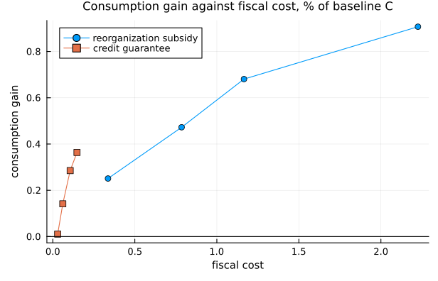

**Implementability.** Medium. No model change, but the guarantee is stylized (a top-up of κ) and would need to be mapped to an actual scheme.

---

## E21. The transition after the reform

**Idea.** Steady-state gains ignore the path. How long does the gain take, and what is it worth including the transition?

**Implementation and what went wrong.** With free entry and a fixed interest rate, the wage is pinned down by the entry condition as long as firms enter. If that held every period, the wage would jump to its new level at once and only the firm distribution would move, which is cheap to compute (`path` in `common.jl`). It does not hold. Entrants are small and grow fast (132 employees at entry, 890 at age 2), so the entrants needed to clear the labor market one year demand far too much labor in the following years. Entry is zero in 16 (ζ/2) and 17 (ζ/3) of the first 30 years, and in those years the wage would have to rise above its new level. The true path has a moving wage, and then values and loan prices change over time: this needs a new solver.

As a second attempt I held entry at its new steady-state level and let the wage clear the labor market each period (`path_static`). This gives the opposite extreme: the wage gain takes about 50 years to reach half, because entry cannot respond.

**Findings.**

- The transition is not solved. The two attempts bracket it:

| | ζ/2 | ζ/3 |
|---|---|---|
| Consumption gain if the new steady state were reached at once | +1.26% | +1.85% |
| Discounted gain with slow, fixed entry | +0.70% | +1.02% |
| Years until half of the rise in the firm mass, fixed entry | 8 | 10 |

- The economy needs many years to build up the larger number of firms; with an exit rate of 7% a year the firm distribution turns over slowly.
- The entry echo is a finding in itself: entry in this model is strongly non-monotone along any transition.

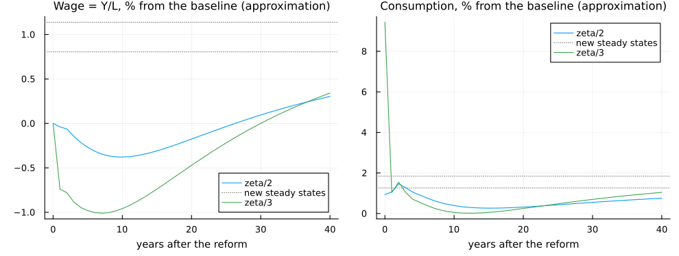

**Implementability.** Hard. A proper transition needs backward iteration of time-varying value functions with the loan-price fixed point in each period, and a search over the wage path: one to two weeks, and the entry-value jumps on the grid will make the wage path hard to pin down.

---

## E22. A one-off revenue shock, with and without the reform

**Idea.** Does a cheaper reorganization make the economy more resilient to a COVID-like shock (Greenwood, Iverson and Thesmar)?

**Implementation.** In year 0 every firm unexpectedly loses a share of its revenue, with wages paid in full. Firms arrive with less cash; those that land where they default are resolved under the law in force. The economy is in its steady state before, with the baseline law or with ζ/3 already in place. The shock year is exact. The recovery path has E21's problem and is not reported.

**Findings (shock year).**

| Revenue lost | Law | Defaults, % of firms | Liquidated | Reorganized | Capital liquidated, % of capital |
|---|---|---|---|---|---|
| none | baseline / ζ/3 | 5.8 / 6.4 | 4.7 / 4.7 | 1.1 / 1.7 | 0.16 / 0.13 |
| 20% | baseline / ζ/3 | 6.7 / 7.7 | 5.1 / 5.3 | 1.5 / 2.5 | 0.30 / 0.26 |
| 30% | baseline / ζ/3 | 8.1 / 8.9 | 5.7 / 5.7 | 2.4 / 3.1 | 1.37 / 0.83 |
| 50% | baseline / ζ/3 | 22.7 / 21.0 | 10.3 / 9.3 | 12.4 / 11.7 | 16.4 / 13.4 |

- Shocks up to 20% cause few extra defaults: firms absorb them by cutting dividends.
- In larger shocks the reform lowers the capital that is liquidated: by 40% in a 30% shock and by 18% in a 50% shock. The number of liquidated firms differs less, so the reform saves the larger firms.
- The model overstates what happens next. Capital can be sold at no cost, so firms that lose cash shed a large part of their capital at once (37% of the capital stock after a 20% shock). A crisis experiment needs adjustment costs or equity issuance to be credible.

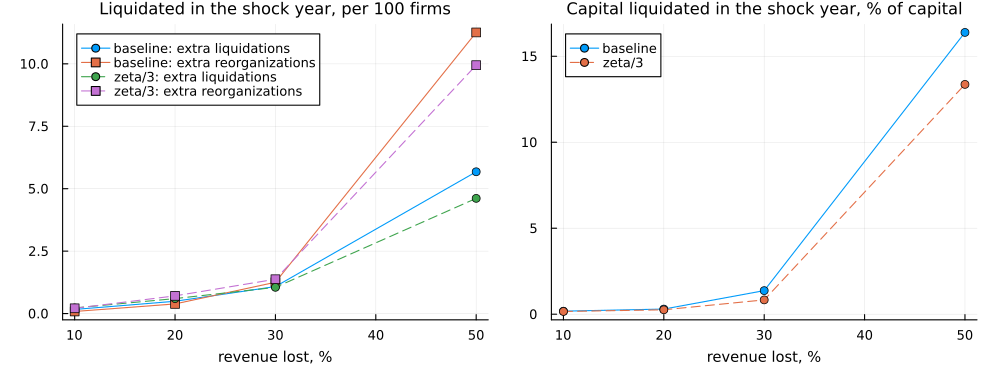

**Implementability.** The shock year is easy. Anything beyond it is hard, for E21's reason and because of the frictionless capital.

---

## H1. E16 with a refit at each φ_a (isolated, heavy)

`H1_phi_a_refit.jl` refits the six internal parameters with `calibrate_lazy` at φ_a = 0.3 and 0.55 (the targets and settings of noise46's calibration block), then solves the ζ/3 reform. It runs in two processes, one per value, each started from this folder with `H1_PHIS` set (PowerShell: `$env:H1_PHIS = '0.3'`, then `julia --project=../../.. H1_phi_a_refit.jl` with Julia 1.12.7). Each fit took 18 minutes. Results are in `out/H1/`.

| φ_a | Fit error (7 targets) | Y/L gain of ζ/3 | Consumption gain | Consumption, main5 entry | Fitted θ | Fitted σ_v |
|---|---|---|---|---|---|---|
| 0.3 (refit) | 0.24 | +1.03% | +1.93% | +1.06% | 0.18 | 1.76 |
| 0.425 (noise46) | 0.20 | +1.14% | +1.85% | +1.00% | 0.22 | 1.54 |
| 0.55 (refit) | 0.25 | +1.41% | +2.00% | +1.36% | 0.34 | 1.45 |

- After a refit both economies match the same moments again (CF reliance 0.56 in both, against 0.69 and about 0.3 without a refit in E16).
- The gain is not larger where assets are worth less. If anything it rises with φ_a (1.03% to 1.41%), because the refit raises the lender's share θ and lowers the noise there.
- Single lazy fits differ by about ±0.3 in Y/L (seen in the calibration search), so the three numbers are not clearly different. The conclusion of E16 stands: no pledgeability gradient in the reform gain.

**Implementability.** Medium: the code is short, and a full calibration at each φ_a (about four hours each) would be needed to trust a gradient.

---

## What I would take to the paper

1. **E07 channels and E12 liquidation rule.** Together they are the argument of the paper in numbers: the reform works only through loan pricing, and a court that looks only at the moment of default liquidates too much. The second holds without noise too (E12b).
2. **E06 break-even.** It reconciles conflicting evidence with one number: the Y/L gain of halving ζ is gone if lenders' share falls by 29%.
3. **E01 welfare, E02 dynamics, E03 Subchapter V check.** Standard tables the paper lacks. E01 needs the entry timing settled.
4. **E04 and E10.** Who responds: the lower middle of the size distribution, and firms of every age.
5. **E09** is a warning, not a result: the fitted noise implies far more court error than the literature finds.

Not worth pursuing in this model: eligibility by debt versus capital (E13, no difference), the pledgeability gradient (E16, flat), fire sales (E18, small).
